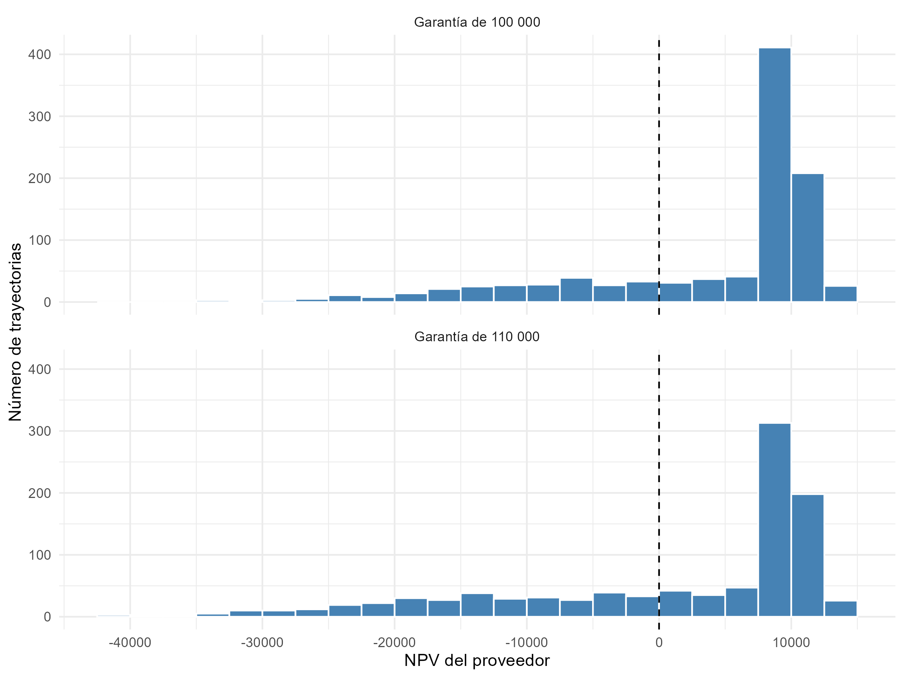

\newpage

El objetivo del presente informe radica en presentar los principales resultados obtenidos a partir tanto de las proyecciones como de las estimaciones ejecutadas en el archivo `Codigo_proyecto_CA0309.qmd`. En caso de que se requiera efectuar consultas a mayor profundidad sobre los datos extendidos, es preciso dirigirse al recurso mencionado y revisar el apartado denominado de la misma manera que la sección en la que está contenida la información a consultar. Asimismo, es importante destacar que la división de los resultados responde a las secciones establecidas en las indicaciones del proyecto: A. Población, decrementos y multiestado; B. Varias vidas; C. Flujos, reservas suministradas y profit testing; D. Escenario adverso y respaldo de las reservas; E. Equity-linked y rentabilidad estocástica y F. Interpretación conceptual de NIIF 17. 

# A. Población, decrementos y multiestado

En primer lugar, con el objetivo de construir la base de proyección del proyecto se partió de la población activa registrada, a la cual se le aplicó diversos filtros de acuerdo a las especificaciones extendidas. De esta forma, el resumen estadístico de la población activa resultante fue el siguiente: 

\begin{table}[H]
\centering
\caption{Resumen estadístico de la población por sexo}
\begin{tabular}{|c|c|c|}
\hline
\textbf{Dato} & \textbf{Sexo femenino} & \textbf{Sexo masculino} \\ \hline
Población total & 52652 & 51353 \\ \hline
Edad promedio & 56,82278 & 56,78481 \\ \hline
Edad mediana & 57 & 57 \\ \hline
Edad mímina & 4 & 1 \\ \hline
Edad máxima & 96 & 96 \\ \hline
Desviación estándar de la edad & 23,30553 & 23,39498 \\ \hline
Edad con la mayor cantidad de registros & 40 & 40\\ \hline
\end{tabular}
\end{table}

Es preciso mencionar que la tabla anterior refleja la exclusión acumulativa de un total de 136 registros sin una fecha de nacimiento válida y un único registro sin un sexo válido, las demás condiciones de exclusión también fueron verificadas, no obstante, no se encontraron registros por excluir. Lo anterior puede responder a dos situaciones: la ausencia de entradas que incumplan las condiciones establecidas o la exclusión previa de dichas entradas tras evaluar otras condiciones. Por otro lado, la población inicial utilizada tiene un valor de $N_{0} = 104005$, número que coincide con la suma de la población total registrada por sexo. Seguidamente, se presenta la distribución anual de la población por causa, obtenida tras efectuar la proyección por un plazo de cinco años. 

\begin{longtable}{|c|c|c|c|c|c|}
\caption{Distribución anual de la población por causa} \\

\hline
\textbf{Año} & \textbf{Sexo} & \textbf{Población inicial} & \textbf{Fallecimientos anuales} & \textbf{Renuncias anuales} & \textbf{Población final} \\ 
\hline
\endfirsthead

\hline
\textbf{Año} & \textbf{Sexo} & \textbf{Población inicial} & \textbf{Fallecimientos anuales} & \textbf{Renuncias anuales} & \textbf{Población final} \\ 
\hline
\endhead

2026 & Femenino & 52652,00 & 357,3064 & 1574,107 & 50720,59 \\ \hline
2026 & Masculino & 51353,00 & 613,2966 & 1531,224 & 49208,48 \\ \hline
2027 & Femenino & 50720,59 & 366,2522 & 1516,025 & 48838,31 \\ \hline
2027 & Masculino & 49208,48 & 617,5724 & 1466,820 & 47124,09 \\ \hline
2028 & Femenino & 48838,31 & 374,6204 & 1459,427 & 47004,26 \\ \hline
2028 & Masculino & 47124,09 & 620,8349 & 1404,235 & 45099,02 \\ \hline
2029 & Femenino & 47004,26 & 382,3941 & 1404,284 & 45217,58 \\ \hline
2029 & Masculino & 45099,02 & 623,2133 & 1343,443 & 43132,36 \\ \hline
2030 & Femenino & 45217,58 & 389,5414 & 1350,573 & 43477,47 \\ \hline
2030 & Masculino & 43132,36 & 624,6102 & 1284,419 & 41223,33 \\ \hline

\end{longtable}

En el archivo `Codigo_proyecto_CA0309.qmd` se verificó que la población inicial de cada año coincidiera con la suma de los fallecimientos anuales, las renuncias anuales y la población final, admitiendo una pequeña tolerancia debido a la limitación decimal de la computadora. Asimismo, es posible notar en la tabla que la población inicial de todos los años exceptuando al 2026, coincide con la población final del año anterior, de manera que se guarda la coherencia en los cálculos. En lo que concierne a las matrices de trasición, se verificó en el mismo archivo que las probabilidades en sus filas sumaran una unidad, admitiendo una pequeña tolerancia. 

# B. Varias vidas

## Población y asignación de parejas hipotéticas

Se trabajó con 104 005 activos, clasificados según su edad inicial al 31 de diciembre de 2025. Los menores de 30 años se consideraron sin pareja, mientras que a los de 30 años o más se les asignó una pareja hipotética de sexo opuesto. Las cantidades por cada grupo se muestran a continuación:

| Clasificación                         | Cantidad |
|---------------------------------------|---------:|
| Activos sin pareja hipotética         |    6 755 |
| Activos con pareja hipotética         |   97 250 |
| Exclusiones propias de B              |        0 |
| Parejas admisibles para la valoración |   97 250 |

: Clasificación de los activos y parejas hipotéticas admisibles para la valoración en la sección B. {#tbl-clasificacion-parejas}

Por otro lado, la edad inicial del cónyuge se asignó según la edad y el sexo del activo. Entre los 30 y 34 años, ambos tenían la misma edad. Entre los 35 y 54 años, se supuso que el cónyuge era tres años menor si el activo era hombre y tres años mayor si era mujer. A partir de los 55 años, la diferencia fue de cinco años en el mismo sentido.

La pareja asignada y la diferencia de edad se mantuvieron durante los cinco años. Por ello, quienes tenían menos de 30 años al inicio permanecieron sin pareja en esta proyección. Se verificó que la edad inicial del cónyuge no excediera 106 años y que existieran probabilidades de mortalidad para ambas personas durante todo el horizonte.

## Proyección de los estatus de supervivencia

Se supuso independencia entre los tiempos futuros de vida del activo y su cónyuge. La supervivencia de cada persona se calculó acumulando las probabilidades anuales correspondientes a su sexo y edad, actualizando esta última cada año.

Se utilizó exclusivamente mortalidad (biológica), sin incorporar renuncia. Los resultados se agregaron utilizando las cantidades iniciales de parejas de cada cohorte, sin aplicar nuevamente la proyección demográfica de A.

La siguiente tabla presenta las cantidades esperadas de parejas que cumplen cada estatus al cierre del año, equivalentes al número esperado de pagos de una unidad.

| Año  | Ambos vivos | Al menos uno vivo | Cónyuge vivo con activo fallecido |
|------|------------:|------------------:|----------------------------------:|
| 2026 |   95 249,78 |         97 207,37 |                            934,48 |
| 2027 |   93 260,79 |         97 082,26 |                          1 830,69 |
| 2028 |   91 278,01 |         96 878,78 |                          2 692,85 |
| 2029 |   89 296,64 |         96 600,59 |                          3 524,76 |
| 2030 |   87 312,19 |         96 250,83 |                          4 329,45 |

: Número esperado de parejas por estado de supervivencia entre 2026 y 2030. {#tbl-estados-supervivencia}

Las cantidades esperadas de parejas con ambos integrantes vivos disminuyen de 95 249,78 al cierre de 2026 a 87 312,19 al cierre de 2030. Esto ocurre porque, conforme transcurren los años, aumenta la posibilidad de que al menos una de las dos personas haya fallecido.

La cantidad correspondiente al último sobreviviente también disminuye, pero más lentamente. Para cumplir este estatus basta con que una de las dos personas siga viva; por eso incluye tanto a las parejas en que ambos viven como a aquellas en que solo vive uno.

En cambio, la cantidad esperada de cónyuges vivos con el activo fallecido aumenta de 934,48 a 4 329,45 durante estos cinco años. Esta columna muestra cuántas parejas se espera que estén en esa situación al cierre de cada año. No representa fallecimientos nuevos ocurridos durante ese año. Las cantidades pueden ser fraccionarias porque son valores esperados, calculados al agregar las probabilidades de todas las parejas admisibles.

## Valores presentes de las rentas unitarias

Para cada estatus se valoró una renta temporal que paga una unidad monetaria al cierre de cada año en que se cumple la condición correspondiente. Se utilizó un horizonte de cinco años y una tasa anual efectiva de descuento del 4 %.

| Cobertura alternativa | VP agregado | VP promedio por pareja inicial |
|-----------------------|------------:|-------------------------------:|
| Vida conjunta         |  407 052,39 |                       4,185629 |
| Último sobreviviente  |  431 037,26 |                       4,432260 |
| Cónyuge sobreviviente |   11 556,52 |                       0,118833 |

: Valor presente agregado y promedio por pareja inicial de las tres coberturas alternativas. {#tbl-valores-presentes}

La renta de último sobreviviente tiene el mayor VP agregado, 431 037,26, porque paga al cierre de cada año en que al menos una persona siga viva, incluso cuando ambas sobreviven. La renta de vida conjunta alcanza 407 052,39 y solo paga mientras ambos estén vivos; sus pagos cesan tras el primer fallecimiento.

La renta al cónyuge sobreviviente tiene el menor VP, 11 556,52. Para recibir un pago, el activo debe haber fallecido y el cónyuge debe seguir vivo al cierre de ese año. Esta situación puede dar lugar a varios pagos durante los cinco años. Los VP promedio por pareja inicial son, respectivamente, 4,432260, 4,185629 y 0,118833.

Son tres coberturas alternativas y sus VP no se suman entre sí ni a los flujos del seguro colectivo de C. Este último paga por el fallecimiento cubierto del activo; la renta al cónyuge depende además de su supervivencia en cada fecha de pago.

## Verificaciones y limitaciones

Se verificó que las parejas admisibles coinciden con el total de sus cohortes, que cada cohorte tiene cinco observaciones y que las probabilidades de los cuatro estados disjuntos suman uno, con una tolerancia mínima por redondeo.

Los resultados se basan en parejas hipotéticas, diferencias de edad fijadas por el enunciado e independencia entre vidas. Por ello, no describen cónyuges observados ni incorporan riesgos compartidos, y deben interpretarse dentro del horizonte de cinco años.

# C. Flujos, reservas suministradas y profit testing

Se proyectaron durante cinco años las primas, los gastos, las comisiones y los beneficios por fallecimiento de la cartera, a partir de los activos y los fallecimientos esperados de A. Las primas, los gastos y las comisiones se pagan al inicio de cada año y dependen de los contratos vigentes en ese momento, además los beneficios se pagan al cierre y dependen de los fallecimientos esperados del año. Se utilizaron las reservas suministradas por contrato vigente al cierre (40 000, 35 000, 25 000, 15 000 y 0), de modo que la reserva total es ese importe multiplicado por los activos al cierre.

  

El resultado anual de la cartera, $\Pi_t$, se calculó con el esquema de *profit testing*.

  

\begingroup\small

  

\begingroup\small

| Año | Activos al inicio | Fallecimientos esperados | Primas (M) | Gastos y comisiones (M) | Beneficios (M) | Reserva final (M) | Resultado (M) |
|:-----|---------------:|--------------:|-----------:|------------:|-----------:|-----------:|------------:|
| 2026 | 104 005,0000 | 970,6030 | 5 200,2500 | 1 300,0625 | 4 853,0148 | 3 997,1626 | -4 754,9805 |
| 2027 | 99 929,0658 | 983,8246 | 4 996,4533 | 1 249,1133 | 4 919,1231 | 3 358,6839 | -146,0792 |
| 2028 | 95 962,3959 | 995,4554 | 4 798,1198 | 1 199,5299 | 4 977,2768 | 2 302,5820 | 25,2787 |
| 2029 | 92 103,2788 | 1 005,6074 | 4 605,1639 | 1 151,2910 | 5 028,0372 | 1 325,2492 | -309,0087 |
| 2030 | 88 349,9438 | 1 014,1516 | 4 417,4972 | 1 104,3743 | 5 070,7582 | 0,0000 | -200,4676 |

: Flujos, reservas y resultado anual de la cartera en el caso base (M = millones de unidades monetarias). {#tbl-flujos-base}

\endgroup

  

\endgroup

  

El resultado es negativo en los años 1, 2, 4 y 5, y solo el año 3 muestra una ganancia pequeña, de 25,3 M.

  

## Desglose del año 1

  

Al inicio del año 1 se emiten 104 005 contratos. Cada uno paga una prima de 50 000, y se pagan 10 000 de gasto y 2 500 de comisión (5 % de la prima), de modo que quedan 37 500 por contrato. Luego se tienen 3 900,2 M en la cartera (primas de 5 200,3 M menos costos de 1 300,1 M). Como la reserva inicial es cero, no hay recursos liberados de reserva. Esos 3 900,2 M generan el rendimiento del 5 % y llegan a 4 095,2 M al cierre. De ese monto se restan los beneficios esperados de 4 853 M y la reserva final de 3 997,2 M. El resultado es $\Pi_1=-4\,754{,}9805$ M.

  

| Concepto | Monto |
|:---|---:|
| Reserva inicial total | 0,0000 |
| Primas netas de gasto y comisión | 3 900 187 500,0000 |
| Fondos acumulados al cierre, con rendimiento | 4 095 196 875,0000 |
| Beneficios por fallecimiento | 4 853 014 765,4822 |
| Reserva final total | 3 997 162 633,4776 |
| Resultado de cartera | -4 754 980 523,9598 |

: Desglose del cálculo del año 1 (unidades monetarias). {#tbl-desglose-anio1}

  

## Recursos y aportes

  

Los recursos parten de 100 000 menos 75 000 de costo de adquisición por contrato emitido, entonces se tienen recursos iniciales de 2 600,1 M. Cada año se les suman las primas menos gastos y comisiones, se aplica el rendimiento y se restan los beneficios, de esta forma se obtiene el saldo de cierre antes de aporte. Si es negativo, el aporte cubre exactamente el déficit y el año siguiente comienza con saldo cero.

  

| Año | Periodo | Recursos al inicio (M) | Saldo antes de aporte (M) | Aporte (M) | Recursos después del aporte (M) |
|:-----|:--------|--------------:|---------------:|-----------:|----------------:|
| 2026 | 1 | 2 600,1250 | 1 972,3134 | 0,0000 | 1 972,3134 |
| 2027 | 2 | 1 972,3134 | 1 086,5129 | 0,0000 | 1 086,5129 |
| 2028 | 3 | 1 086,5129 | -57,9189 | 57,9189 | 0,0000 |
| 2029 | 4 | 0,0000 | -1 401,4706 | 1 401,4706 | 0,0000 |
| 2030 | 5 | 0,0000 | -1 591,9792 | 1 591,9792 | 0,0000 |

: Recursos y aportes por año en el caso base (M = millones de unidades monetarias). {#tbl-fondos-base}
  

El saldo es positivo en los años 1 y 2 y se vuelve negativo desde el año 3, cuando aparece el primer aporte de 57,9 M. El saldo mínimo antes de aportes es de -1 592 M y los aportes suman 3 051,4 M.

  

## NPV, margen y resultado económico frente a efectivo

  

El NPV descuenta al 4 % los resultados de cierre y suma el gasto de adquisición, una sola vez, en el momento inicial. Es de -12 914 M. El valor presente de las primas, descontadas desde su momento de pago, es de 22 310,7 M, por lo que el margen es de -57,88 % por cada unidad de prima descontada

  

El resultado económico y el efectivo no coinciden. El resultado $\Pi_t$ descuenta la reserva final, porque es una obligación futura, por otro lado, el efectivo no la incluye, porque la reserva no es una entrada ni una salida de caja. Por eso en los años 1 y 2 hay pérdida económica con saldo de efectivo positivo, y en el año 3 ocurre lo contrario, pues el resultado económico positivo pero saldo negativo.

# D. Escenario adverso y respaldo de las reservas

## Escenario adverso

En el escenario adverso el gasto anual es de 11 000 por contrato vigente y el rendimiento anual es del 4 %. Con estos datos se recalcularon los flujos, los resultados y los recursos, y se comparan con el escenario base en la @tbl-adverso.

| Caso | NPV (M) | Margen | Saldo mínimo (M) | Total aportes (M) | Respaldo año 1 (M) |
|:-----------|--------------:|---------:|--------------:|--------------:|--------------:|
| Base | -12 913,9692 | -0,5788 | -1 591,9792 | 3 051,3687 | -2 024,8493 |
| Adverso | -13 618,4683 | -0,6104 | -1 716,9944 | 3 808,2285 | -2 198,0176 |
| Diferencia | -704,4991 | -0,0316 | -125,0152 | 756,8598 | -173,1683 |

: Comparación entre el escenario base y el adverso (M = millones de unidades monetarias; la fila Diferencia es adverso menos base). {#tbl-adverso}

El escenario adverso empeora los cuatro indicadores: el NPV pasa de -12 913,9692 M a -13 618,4683 M, el saldo mínimo antes de aportes de -1 591,9792 M a -1 716,9944 M, los aportes totales de 3 051,3687 M a 3 808,2285 M y el respaldo del año 1 de -2 024,8493 M a -2 198,0176 M. Tanto el gasto adicional como la reducción del rendimiento disminuyen los fondos acumulados antes de restar los beneficios esperados y la reserva de fin de año, luego como no se calcularon efectos separados, no se atribuye una parte del deterioro a cada parámetro.

Los recursos no cubren la reserva suministrada en ninguno de los dos escenarios. Al cierre del año 1 y antes del aporte, los recursos son de 1 972,3134 M en el base y de 1 799,1450 M en el adverso, frente a una reserva de 3 997,1626 M, es decir, cubren el 49,34 % y el 45,01 % de la reserva, respectivamente. El faltante ya existe en el caso base, por lo que el escenario adverso solo lo empeora.

Se recomienda aumentar la prima anual. En el año 1, el costo esperado de los fallecimientos, de 46 661,3602 por contrato, supera la prima neta de gasto y comisión, que es de 37 500,0000 en el base y de 36 500,0000 en el adverso. Para que los recursos igualen la reserva al cierre del año 1 en el escenario adverso, la prima anual debería ser de al menos 71 390,4540 por contrato (69 517,5625 en el base), un aumento de 42,78 % (39,04 %) respecto a 50 000. Con esa prima, los recursos también cubren la reserva en los años siguientes. Este nivel es un mínimo para cubrir la reserva y no garantiza un NPV positivo.

## Aumento del beneficio por fallecimiento

Adicionalmente, se evaluó el aumento del beneficio por fallecimiento de 5 000 000 a 5 500 000, con la prima anual de 50 000 y los demás parámetros del caso base. Este cálculo es independiente del escenario adverso:

| Caso | VP beneficios (M) | NPV (M) | Margen | Saldo mínimo (M) | Total aportes (M) | Respaldo año 1 (M) |
|:-----------|-------------:|--------------:|---------:|-------------:|-------------:|-------------:|
| Base | 22 104,9280 | -12 913,9692 | -0,5788 | -1 591,9792 | 3 051,3687 | -2 024,8493 |
| Beneficio mayor | 24 315,4208 | -15 124,4620 | -0,6779 | -2 099,0550 | 5 610,5287 | -2 510,1508 |
| Diferencia | 2 210,4928 | -2 210,4928 | -0,0991 | -507,0758 | 2 559,1600 | -485,3015 |

: Comparación entre el beneficio de 5 000 000 (base) y el de 5 500 000 (M = millones de unidades monetarias; la fila Diferencia es beneficio mayor menos base). {#tbl-extra}

Como los fallecimientos esperados no cambian, el valor presente de los beneficios aumenta exactamente 10 %, en 2 210,4928 M, y el NPV disminuye en esa misma cantidad. El saldo mínimo antes de aportes baja de -1 591,9792 M a -2 099,0550 M y los aportes totales suben de 3 051,3687 M a 5 610,5287 M. Note que el primer aporte sigue apareciendo en el año 3, pero es de 1 607,1994 M en lugar de 57,9189 M. Al cierre del año 1, los recursos antes del aporte son de 1 487,0119 M frente a una reserva de 3 997,1626 M, es decir, cubren el 37,20 % (49,34 % en el base).

Al igual que en el caso base y en el adverso, la prima cobrada no alcanza para cubrir el pago esperado por fallecimiento, y el aumento del beneficio aumenta lo faltante. En el año 1, el costo esperado de fallecimientos por contrato pasa de 46 661,3602 a 51 327,4962, que supera incluso la prima de 50 000. Por ello, en los tres casos los recursos no cubren la reserva suministrada y se requieren aportes adicionales.

# E. Equity-linked y rentabilidad estocástica

## Simulación y valoración del proveedor

Se analizó una cuenta individual representativa de un hombre de 45 años al inicio, independiente de la base de activos y de las parejas de la sección B, por lo que sus resultados no se agregan a los de la cartera. La cuenta parte de 100 000 sin aportaciones posteriores. El cargo del 2 % anual se calculó sobre el saldo al inicio de cada año y se dedujo antes del rendimiento, y el logrendimiento anual se generó con una distribución normal de media 0,04 y desviación estándar 0,15, independiente entre años y trayectorias. Se simularon 1 000 trayectorias de cinco años en R (versión 4.5.1) con semilla 2026, las mismas para las garantías de 100 000 y de 110 000. Una implementación en otro lenguaje podría producir una muestra distinta aun con la misma semilla.

Cada cargo se ponderó por la permanencia al inicio del año, calculada con mortalidad y renuncia del 3 % actuando simultáneamente y con la edad actualizada cada año, y se descontó desde ese momento al 4 %. El complemento es la diferencia positiva entre la garantía y el saldo al cierre del año 5; se ponderó por la permanencia al vencimiento y se descontó cinco años. El NPV del proveedor es el VP de los cargos menos el VP del complemento. Se supuso independencia entre los rendimientos y la permanencia. Al salir por fallecimiento o renuncia se devuelve el saldo de la cuenta sin complemento, financiado con la propia cuenta, y el aporte inicial del cliente no se consideró ingreso del proveedor.

No se simularon fallecimientos ni renuncias individuales, por lo que la frecuencia de pérdida y el CTE95 corresponden al resultado con expectativa biométrica de cada trayectoria financiera. El CTE95 es el promedio de las 50 mayores pérdidas, definidas como el negativo del NPV.

## Resultados comparativos

La siguiente tabla compara las dos garantías desde la perspectiva del proveedor:

| Garantía | Probabilidad de activación | VP medio del complemento | NPV medio | Frecuencia de pérdida | CTE95 |
|---------:|--------------------:|--------------------:|-----------:|------------------:|---------------:|
| 100 000  | 36,7 %                     | 5 126,70                 | 4 054,40  | 24,6 %                | 22 959,79 |
| 110 000  | 48,5 %                     | 8 087,64                 | 1 093,46  | 33,9 %                | 29 892,45 |

: Comparación de las garantías de 100 000 y 110 000 desde la perspectiva del proveedor. {#tbl-garantias}

Los importes están en unidades monetarias. La probabilidad de activación es la proporción de trayectorias en que el saldo final queda por debajo de la garantía y el proveedor debe pagar un complemento. No equivale a la frecuencia de pérdida, que cuenta las trayectorias en que el VP del complemento supera el VP de los cargos cobrados.

La @fig-hist-npv muestra el NPV del proveedor con los mismos cortes y escalas en ambos paneles; la línea punteada marca el NPV igual a cero. En ambos paneles la mayor parte de las trayectorias se concentra a la derecha de cero, con la barra más alta entre 7 500 y 10 000, y ningún valor supera 15 000. A la izquierda de cero hay una cola larga que llega hasta cerca de -34 000 con la garantía de 100 000 y hasta cerca de -41 000 con la de 110 000. Con la garantía de 110 000 la barra más alta disminuye de aproximadamente 410 a 310 trayectorias y la cola izquierda se extiende y pesa más.

{#fig-hist-npv width="90%" fig-pos="H"}

## Detalle de una trayectoria

Se detalla la trayectoria 4, la primera en que se activa la garantía de 100 000. La cuenta cerró el año 5 con un saldo de 68 442,32, inferior a ambas garantías, por lo que el complemento fue de 31 557,68 con la garantía de 100 000 y de 41 557,68 con la de 110 000. El VP de los cargos, 8 242,89, es el mismo en ambos casos porque la cuenta y los cargos no dependen de la garantía.

| Garantía | Saldo final | Complemento | VP del complemento | VP de los cargos | NPV        |
|---------:|------------:|------------:|-------------------:|-----------------:|-----------:|
| 100 000  | 68 442,32   | 31 557,68   | 21 877,86          | 8 242,89         | -13 634,97 |
| 110 000  | 68 442,32   | 41 557,68   | 28 810,52          | 8 242,89         | -20 567,63 |

: Detalle de la trayectoria 4 bajo ambas garantías. {#tbl-trayectoria}

El VP del complemento equivale a aproximadamente 0,6933 veces el complemento, factor que combina la permanencia al vencimiento y el descuento de cinco años. Así, los 10 000 adicionales de complemento elevan su VP en 6 932,66 y el NPV baja en esa misma cantidad. El detalle año a año de la cuenta se presenta en el anexo (@tbl-anexo-cuenta).

## Efecto de la garantía y recomendación

El aumento de la garantía reduce la rentabilidad y aumenta el riesgo. El VP medio del complemento sube 2 960,94 (57,8 %) y, como los cargos son los mismos, el NPV medio baja esa misma cantidad, una caída del 73,0 %. La probabilidad de activación sube 11,8 puntos porcentuales, la frecuencia de pérdida 9,3 puntos y el CTE95 aumenta 6 932,66 (30,2 %). Esta última diferencia coincide con la de la trayectoria 4 porque las 50 peores trayectorias son las mismas con ambas garantías y en todas el saldo final queda por debajo de ambas.

La frecuencia de pérdida es menor que la probabilidad de activación porque un complemento pequeño se compensa con el VP de los cargos; el proveedor solo pierde cuando el complemento descontado supera esos cargos. El NPV está acotado superiormente por el VP de los cargos y la pérdida crece a medida que el saldo final cae.

Se recomienda la garantía de 100 000, que es mejor en las cuatro medidas comparadas: menor VP medio del complemento, mayor NPV medio, menor frecuencia de pérdida y menor CTE95. Subir la garantía a 110 000 con el mismo cargo del 2 % reduce el NPV medio en casi tres cuartas partes y aumenta las pérdidas de cola sin ingreso adicional para el proveedor; ofrecerla requeriría revisar el cargo, lo cual no se evaluó. Se verificó en el código que, con cargo y trayectorias iguales, la garantía mayor no disminuye el complemento ni aumenta el NPV en ninguna de las 1 000 trayectorias. Los resultados son estimaciones a partir de una muestra de 1 000 trayectorias.

# F. Interpretación conceptual de NIIF 17

## 1. ¿Qué flujos del contrato considerarían en su medición inicial y qué función cumple el ajuste por riesgo no financiero, RA?

Se considerarían las primas anuales de 50 000 por contrato vigente, los beneficios por fallecimiento de 5 000 000 y los gastos, comisiones y adquisición directamente atribuibles. En el caso, estos últimos corresponden a 10 000 anuales por vigente, el 5 % de las primas y 75 000 iniciales por contrato. Se respetarían sus fechas de pago y el límite contractual, ponderando los flujos por mortalidad y permanencia. La renuncia termina la cobertura y las primas, sin devolución.

El RA representa la compensación exigida por asumir incertidumbre en el importe y momento de los flujos derivada de riesgos no financieros, como mortalidad, renuncia y gastos. Complementa la estimación de los flujos esperados y su descuento.

## 2. ¿Qué representa la CSM y qué diferencia existe entre el tratamiento inicial de un grupo de contratos rentable y uno oneroso?

La CSM representa la ganancia no devengada correspondiente a servicios futuros. En el modelo general, la ganancia inicial de un grupo rentable se difiere mediante la CSM y se reconoce conforme se prestan los servicios. Si el grupo es oneroso al inicio, la pérdida se reconoce inmediatamente y la CSM es cero.

Para este seguro, la clasificación requiere considerar conjuntamente primas, beneficios, gastos, adquisición y RA. Cobrar primas superiores a los siniestros esperados no basta para demostrar rentabilidad bajo NIIF 17.

## 3. ¿Por qué un NPV positivo en *profit testing* no permite concluir por sí solo que exista una CSM positiva? Consideren propósito, supuestos y componentes de ambas mediciones.

El NPV de C evalúa rentabilidad bajo los supuestos del ejercicio, incluidos rendimiento del 5 %, descuento del 4 %, adquisición y reservas suministradas. La CSM responde a reglas de medición y reconocimiento contable que consideran agrupación, límite contractual, supuestos actuales, descuento apropiado, RA y flujos al reconocimiento inicial.

Por ello, un NPV positivo no garantiza una CSM positiva. El rendimiento supuesto de las inversiones y las reservas académicas tampoco se trasladan automáticamente a la medición NIIF 17.

## 4. ¿Por qué CSM, reserva suministrada y efectivo disponible son conceptos distintos?

La CSM representa ganancia futura pendiente de reconocer. La reserva suministrada es un supuesto académico por contrato vigente, utilizado en el *profit testing*; no constituye una medición NIIF 17. El efectivo disponible corresponde a los recursos para realizar pagos.

En el caso, liberar reserva no genera un cobro y recibir aportes incrementa el efectivo, sin constituir utilidad ni CSM. Asimismo, una reserva suministrada de cero al finalizar el año 5 no determina por sí sola el saldo de efectivo.

\newpage

# Contibuciones individuales

| Integrante | Actividad realizada | Evidencia o archivo verificable |
|:---|:---|:---|
| Estudiante A: Estefanía | Programación del código de la sección B de varias vidas y redacción de las secciones B y F del informe. | `Codigo_proyecto_CA0309`, sección B; `Informe_proyecto_CA0309`, secciones B y F. |
| Estudiante B: Alexandra | Programación del código de la sección A: población, decrementos y multiestado. Redacción de la sección A en el informe.| `Codigo_proyecto_CA0309`, sección A; `Informe_proyecto_CA0309`, sección A.|
| Estudiante C: Daniela | Programación del código de la sección E de equity-linked (simulación de la cuenta individual, valoración del proveedor y comparación de garantías) y redacción de la sección E del informe. | `Codigo_proyecto_CA0309`, sección E; `Informe_proyecto_CA0309`, sección E. |
| Estudiante D: César |  |  |

## Declaración de uso de IA y otras ayudas

| Integrante | Herramienta y uso | Verificación |
|:---|:---|:---|
| Estefanía |  |  |
| Alexandra |  |  |
| César |  |  |
| Daniela | 	Claude: apoyo en la corrección del código de la sección E, sugerencias para mejorar el histograma y orientación para exportar las tablas.| Se ejecutó el código completo y se comprobó que los valores obtenidos fueran consistentes con los resultados esperados y las verificaciones de la sección E. |

\newpage

# Anexos

Detalle año a año de la trayectoria 4

| Año | Saldo al inicio | Cargo (2 %) | Logrendimiento | Saldo al cierre | Permanencia al inicio | Factor de descuento | VP del cargo |
|----:|----------------:|------------:|---------------:|----------------:|----------------------:|--------------------:|-------------:|
| 1 | 100 000,00 | 2 000,00 | 0,0273 | 100 711,01 | 1,00000 | 1,00000 | 2 000,00 |
| 2 | 100 711,01 | 2 014,22 | -0,0124 | 97 481,04 | 0,96682 | 0,96154 | 1 872,49 |
| 3 | 97 481,04 | 1 949,62 | -0,0838 | 87 852,69 | 0,93463 | 0,92456 | 1 684,69 |
| 4 | 87 852,69 | 1 757,05 | -0,0081 | 85 404,83 | 0,90336 | 0,88900 | 1 411,07 |
| 5 | 85 404,83 | 1 708,10 | -0,2012 | 68 442,32 | 0,87299 | 0,85480 | 1 274,64 |

: Cuenta, cargos y VP de los cargos de la trayectoria 4; la suma de los VP de los cargos es 8 242,89. {#tbl-anexo-cuenta}